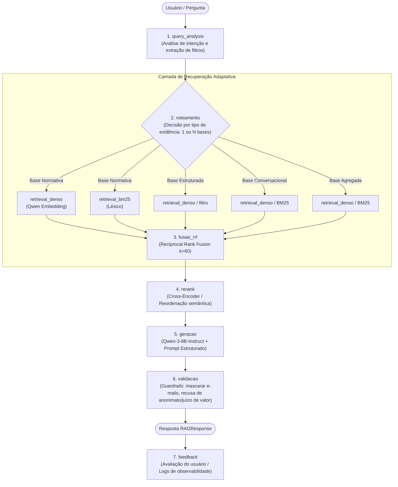

# Arquitetura do Sistema · Cenário 3 (Inteligência sobre Pesquisa Acadêmica)

## 1. Cenário Escolhido e Justificativa
> **Cenário 3 · Inteligência sobre Pesquisa Acadêmica**
> 
> Escolhemos este cenário pelo desafio central de fusão de evidências (*cross-source*), onde perguntas como *"o dinheiro deste edital virou produção científica?"* exigem articular editais normativos, metadados de financiamento, resumos acadêmicos e pareceres editoriais.
> Além disso, o cenário apresenta a complexidade singular de roteamento entre bases de vocabulário muito próximo (todas tratam de pesquisa), demandando que o roteador raciocine estritamente sobre o **tipo de evidência**, acompanhado de desafios sutis de ética e anonimato em *peer review*.

---

## 2. Diagrama do Pipeline Planejado

O pipeline opera como um **Adaptive RAG**, instrumentado em cada etapa para observabilidade e rastreabilidade de custo de tokens e latência.

### Estágios Padronizados de Log (`stage`):
1. `query_analysis`: Normalização da pergunta, identificação de entidades e extração de filtros estruturados.
2. `roteamento`: Seleção de rotas (`editais_normativo`, `producao_estruturada`, `pareceres_conversacional`, `metricas_agregada` ou multi-base).
3. `retrieval_denso`: Busca vetorial com embeddings (`xagi/qwen3-embedding:0.6b-q4_k_m`) sobre cache persistido.
4. `retrieval_bm25`: Busca esparsa por palavras-chave e termos exatos.
5. `fusao_rrf`: Combinação de rankings com algoritmo Reciprocal Rank Fusion ($k=60$).
6. `rerank`: Reordenação semântica dos top chunks recuperados.
7. `geracao`: Síntese contextual com o modelo de geração (`qcwind/qwen3-8b-instruct-Q4-K-M`).
8. `validacao`: Verificação de guardrails (mascaramento de e-mails, bloqueio de quebra de anonimato de revisores ou ataques a pessoas).
9. `feedback`: Captura de feedback do usuário e persistência do histórico da interação.

---

## 3. Divisão de Responsabilidades por Módulo

| Módulo | Responsável | Atribuições Principais |
|---|---|---|
| **Coleta e Manifesto (`fetch_corpus.py` / `manifest`)** | Membro 1 (Coordenador) | Versionamento do corpus v1/v2, coleta determinística via APIs/PDFs, geração do `CORPUS_INVENTORY.md`. |
| **Ingestão e Chunking (`ingest.py` / `schema.py`)** | Membro 2 | Normalização Pydantic, chunking específico por natureza documental, preservação de metadados obrigatórios. |
| **Indexação e Embeddings (`index.py`)** | Membro 3 | Integração com Ollama embeddings, persistência em disco (`save_local`/`load_local`), cache de vetores e BM25. |
| **Roteamento Adaptativo (`router.py`)** | Membro 4 | Motor de classificação por tipo de evidência, detecção de cross-source e decomposição de consultas compostas. |
| **Recuperação e Fusão (`retrieve.py`)** | Membro 5 | Recuperação híbrida (denso + BM25), aplicação de filtros de metadados e fusão RRF. |
| **Geração, Guardrails e Observabilidade (`generate.py` / `obs.py` / `tests`)** | Membro 6 | Síntese de respostas, mascaramento de e-mails, recusa de quebra de duplo-cego, logs JSONL e testes automatizados. |
