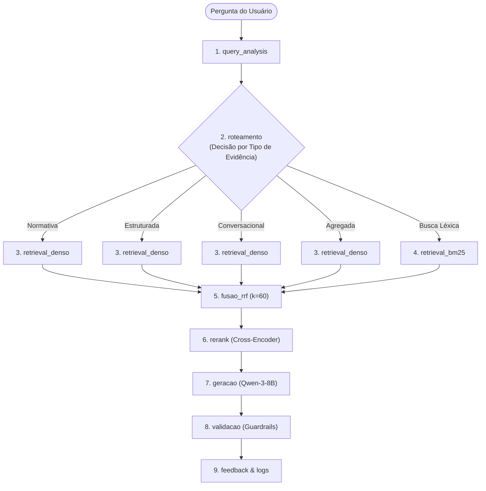

# Inteligência sobre Pesquisa Acadêmica · Adaptive RAG
> **Grande Desafio · IA Generativa & RAG**  
> **Residência TIC em Trilhas · PUC-Rio · Instituto ECOA**  
> **Cenário 3 · Grupo 5**

---

## 📌 Visão Geral do Projeto

Este projeto implementa um sistema de **Adaptive RAG** voltado para responder perguntas complexas e *cross-source* sobre produção científica, editais de fomento e conformidade ética em pesquisa acadêmica.

A pergunta central que o sistema resolve é:  
> **"O dinheiro deste edital virou produção científica?"**

---

## 🏛️ Arquitetura do Pipeline

O sistema é construído sobre **9 estágios padronizados e observáveis**, registrando latência, consumo de tokens e metadados em logs estruturados no formato JSONL (`logs/pipeline-AAAA-MM-DD.jsonl`):



---

## 🛡️ Política de Sensibilidade e Guardrails

| Classificação | Escopo de Dados | Diretriz no Pipeline |
|---|---|---|
| **Público (Responder)** | Artigos, citações, autores, afiliações institucionais, valores de editais. | Recuperação híbrida e resposta transparente baseada em evidências. |
| **Interno (Mascarar)** | E-mails de contato de autores correspondentes. | Sanitização regex automática mascarando para `[E-MAIL PROTEGIDO]`. |
| **Restrito (Recusar)** | Identidade de pareceristas em revisão duplo-cego (*peer review*) e julgamento depreciativo de mérito pessoal. | Bloqueio em `src/generate.py` com `is_refusal = True` e recusa institucional explícita. |

---

## 📂 Estrutura do Repositório

```text
├── Acompanhamento/                  ← Relatos individuais e diários da equipe
├── README.md                        ← Instruções de execução e arquitetura
├── ARQUITETURA.md                   ← Plano técnico e matriz de responsabilidade
├── PERSONAS.md                      ← 3 personas, 9 perguntas e hipótese de erro
├── corpus_manifest.yaml             ← Manifesto declarativo das 4 bases
├── CORPUS_INVENTORY.md              ← Inventário auditável do corpus coletado
├── .env.example                     ← Template de variáveis de ambiente
├── .gitignore                       ← Ignora dados brutos, índices, logs e ambiente
├── requirements.txt                 ← Dependências do projeto
├── config.py                        ← Parâmetros centralizados e cliente OpenAI/Ollama
├── src/
│   ├── fetch_corpus.py              ← Coleta determinística e versionamento (v1/v2)
│   ├── ingest.py                    ← Chunking especializado e metadados
│   ├── index.py                     ← Embeddings com cache em disco e BM25
│   ├── router.py                    ← Adaptive RAG por tipo de evidência
│   ├── retrieve.py                  ← Busca híbrida e fusão RRF (k=60)
│   ├── generate.py                  ← Síntese com LLM e aplicação de Guardrails
│   ├── schema.py                    ← Modelos de dados Pydantic
│   ├── obs.py                       ← Observabilidade, logs JSONL e contagem de tokens
│   └── pipeline.py                  ← Orquestração ponta a ponta
├── tests/
│   ├── fixtures/                    ← Documentos para testes offline
│   ├── test_chunks.py               ← Teste de contrato de metadados obrigatórios
│   ├── test_unitarios.py            ← Testes de cálculo de RRF e contratos
│   ├── test_router.py               ← Testes de roteamento das personas
│   └── test_guardrails.py           ← Testes de mascaramento e recusa ética
├── app/
│   └── cli.py                       ← Interface CLI interativa
├── eval/
│   └── benchmark.py                 ← Execução do benchmark de perguntas
├── data/                            ← raw/ ignorado no Git; inventory/ versionado
└── logs/                            ← Logs JSONL gerados por execução
```

---

## 🚀 Como Executar o Projeto

### 1. Instalação das Dependências
```powershell
pip install -r requirements.txt
```

### 2. Coleta Determinística do Corpus (Gera v1)
```powershell
python -m src.fetch_corpus fetch --manifest corpus_manifest.yaml --version v1
```

### 3. Ingestão e Chunking Especializado
```powershell
python -m src.ingest
```

### 4. Executar o Pipeline Ponta a Ponta
```powershell
python -m src.pipeline
```

### 5. Executar a Interface CLI Interativa
```powershell
python -m app.cli
```

### 6. Rodar os Testes Automatizados (Offline)
```powershell
python -m unittest discover tests
```
